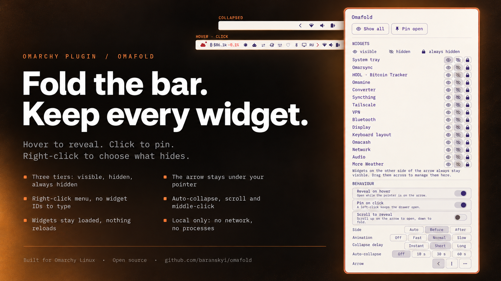

# Omafold

A reveal-on-demand drawer for the Omarchy bar. Put one small arrow into the
bar, and every widget on its far side folds away until you point at it. The
bar stays tidy; nothing you use is more than a hover away.



It follows the model of macOS menu-bar managers: three groups of widgets,
with the controller itself as the border between them.

| Group | Where it lives | When you see it |
|---|---|---|
| **Always visible** | on the near side of the arrow, or listed in `exclude` | always |
| **Hidden** | on the collapsible side of the arrow | hover, click, or keyboard shortcut |
| **Always hidden** | on the collapsible side and listed in `alwaysHidden` | middle-click, the menu's *Show all*, or `showAll` |

Hidden widgets stay loaded. Their timers, state, tooltips and panels keep
working exactly as before; only their width (or height, on a vertical bar)
and opacity change. Nothing is reloaded when the drawer opens.

## Install

```bash
omarchy plugin add https://github.com/baranskyi/omafold.git
omarchy plugin enable io.github.baranskyi.omafold --section right --before omarchy.network
```

The placement matters, because the arrow is the border. In the right section
the drawer hides the widgets **to the left of the arrow**. On the stock
Omarchy layout the line above gives you:

```
[ tray  agents  bluetooth  ‹ ]  [ network  audio  monitor  power ]
  ──────── hidden ────────         ────── always visible ──────
```

Every widget you add later to the left of the arrow folds away with them.

Omarchy Quattro 4.0 or newer is required. There is nothing else to install.

## Choose what hides

The quickest way is the options menu: right-click the arrow, and every widget
on the collapsible side is listed by name with three buttons — visible,
hidden, always hidden. The bar changes as you click.

Which widgets are on the collapsible side is decided by the bar order. Move
widgets across the arrow like any other bar widget: drag them in the bar while
the drawer is pinned open, or use the CLI.

```bash
# Hide Bluetooth: put it on the collapsible side.
omarchy bar move omarchy.bluetooth --before io.github.baranskyi.omafold

# Keep the clock visible: put it on the other side.
omarchy bar move omarchy.clock --after io.github.baranskyi.omafold
```

The menu edits two settings, which you can also set directly. To keep a
widget visible without moving it, add its ID to `exclude`. To tuck a widget
one level deeper, add its ID to `alwaysHidden`:

```bash
omarchy bar set io.github.baranskyi.omafold exclude "omarchy.tray"
omarchy bar set io.github.baranskyi.omafold alwaysHidden "omarchy.monitor, omarchy.keyboard-layout"
```

The IDs of the widgets in a section are listed by:

```bash
jq -r '.bar.layout.right[] | .id? // .' ~/.config/omarchy/shell.json
```

## Use it

| Action | Result |
|---|---|
| Hover the arrow | Reveal hidden widgets. They fold away shortly after the pointer leaves the arrow and the revealed widgets. |
| Left-click the arrow | Pin the drawer open. Click again to fold it. |
| Middle-click the arrow | Reveal everything, always-hidden widgets included. Middle-click again to fold it. |
| Right-click the arrow | Open the options menu. |
| Scroll on the arrow | Up pins the drawer open, down folds it. Off until you enable *Scroll to reveal*. |

The drawer also stays open while a hidden widget's panel or menu is open, so a
panel summoned from the keyboard never points at an empty space.

### Options menu

The menu keeps the drawer open while you use it, so each change shows up in
the bar immediately. It closes when you click anywhere else.

- **Show all / Pin open**: the same as middle-click and left-click.
- **Widgets**: each widget on the collapsible side, by name, with *visible*,
  *hidden* and *always hidden* buttons.
- **Behaviour**: reveal on hover, pin on click, scroll to reveal, the
  collapsible side, animation speed, collapse delay, auto-collapse and the
  arrow's icon.

Every choice is saved at once to the widget's own entry in
`~/.config/omarchy/shell.json`, through Omarchy Shell.

### Keyboard

The controller answers five IPC calls. Every bar on every monitor follows the
first four; `options` opens the menu on one bar.

```bash
omarchy-shell io.github.baranskyi.omafold toggle   # pin open, or fold
omarchy-shell io.github.baranskyi.omafold show     # pin open
omarchy-shell io.github.baranskyi.omafold showAll  # pin open with always-hidden widgets
omarchy-shell io.github.baranskyi.omafold hide     # fold everything
omarchy-shell io.github.baranskyi.omafold options  # open or close the options menu
```

To bind one to a key, add a line to `~/.config/hypr/bindings.lua`:

```lua
o.bind("SUPER + ALT + B", "Toggle bar drawer", "omarchy-shell io.github.baranskyi.omafold toggle")
```

## Settings

Change them in the Omarchy bar settings, with `omarchy bar set`, or directly in
the widget's entry in `~/.config/omarchy/shell.json`:

```json
{
  "id": "io.github.baranskyi.omafold",
  "collapseSide": "auto",
  "revealOnHover": true,
  "revealOnClick": true,
  "animationDuration": 220,
  "collapseDelay": 240,
  "exclude": "",
  "alwaysHidden": "",
  "autoCollapse": 0,
  "scrollReveal": false,
  "arrowStyle": "chevron"
}
```

| Key | Default | Meaning |
|---|---|---|
| `collapseSide` | `auto` | Which side of the arrow folds away: `before`, `after`, or `auto`. `auto` picks the side away from the section's screen edge — `after` in the left section, `before` everywhere else — so the arrow never slides out from under the pointer while the drawer opens. |
| `revealOnHover` | `true` | Reveal hidden widgets when the pointer enters the arrow. |
| `revealOnClick` | `true` | Let a left-click pin the drawer open. |
| `animationDuration` | `220` | Slide duration in milliseconds, `0`–`1000`. `0` switches the animation off. |
| `collapseDelay` | `240` | How long the drawer waits after the pointer leaves, in milliseconds, `0`–`3000`. |
| `exclude` | `""` | Comma-separated widget IDs that stay visible on the collapsible side. |
| `alwaysHidden` | `""` | Comma-separated widget IDs on the collapsible side that appear only with a middle-click, *Show all*, or `showAll`. |
| `autoCollapse` | `0` | Fold a pinned drawer after this many seconds without interaction, `0`–`600`. `0` keeps it open until you fold it. |
| `scrollReveal` | `false` | Scroll up on the arrow to pin the drawer open, down to fold it. |
| `arrowStyle` | `chevron` | The arrow's icon: `chevron`, `dots` or `ellipsis`. Only the chevron turns to show which way the drawer opens. |

When an ID is in both lists, `exclude` wins. Widgets on the visible side of the
arrow are never hidden, whatever the lists say.

## Remove

```bash
omarchy plugin remove io.github.baranskyi.omafold
```

Every widget reappears at once: the sizes the plugin changes exist only in
the running bar and are restored when the controller unloads.

## Permissions and dependencies

- No network access, no processes, no file writes, no elevated privileges.
- It changes only its own entry in `shell.json`, and only when you pick an
  option in its menu. Omarchy Shell writes the file
  (`bar.shell.updateEntryInline`); the plugin never touches it.
- No external dependencies. It uses the QML modules bundled with Omarchy
  Shell and the Nerd Font Omarchy already ships for the arrow glyph.
- It reads the other widget slots in its own bar section to adjust their size
  and opacity. That is the whole integration surface.

## Limitations

- The drawer manages only the section it sits in, and a bar holds one
  controller (`allowMultiple` is off), so place it in your busiest section.
- The center section is centered on screen, so its contents shift by half the
  drawer's width when it opens. The left and right sections do not move.
- Hidden widgets keep running. A widget that polls a service still polls it
  while folded away — that is what keeps its state current when it reappears.

## Development

From a checkout of this repository, link it in place of an installed copy:

```bash
ln -s "$PWD" ~/.config/omarchy/plugins/io.github.baranskyi.omafold
omarchy plugin enable io.github.baranskyi.omafold --section right --before omarchy.network

npm test                              # grouping, settings and tooltip model
omarchy plugin validate .             # manifest against the Omarchy schema
omarchy restart shell                 # when a hot reload does not pick up QML changes
```

| File | Role |
|---|---|
| `BarWidget.qml` | The controller: finds its slot, groups its neighbours, animates them, answers IPC. |
| `OptionsMenu.qml` | The right-click options menu. |
| `DrawerModel.js` | Pure grouping, menu, settings and tooltip logic, shared by the widget and the tests. |
| `manifest.json` | Omarchy plugin manifest and settings schema. |
| `tests/` | `node --test` suite for `DrawerModel.js`. |

## License

MIT — see [LICENSE](LICENSE).
